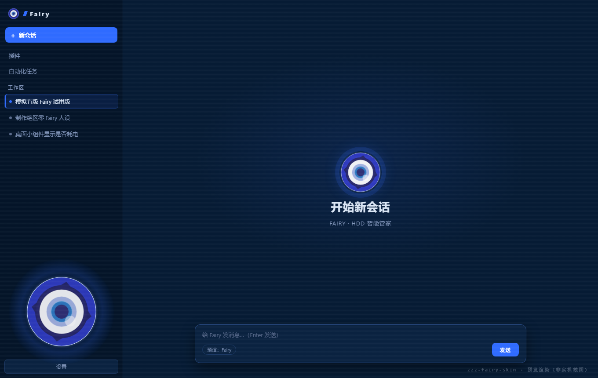

# Fairy 模式 · DeepSeek Harness

把 DeepSeek Harness（DSH）的界面换成《绝区零》HDD 风格，并把会话人格切换成 **Fairy（菲茵）**——冷静、可靠、偶尔一本正经拆台的首席助手。

这是一个**非官方粉丝项目**，不包含 DSH 本体，也不修改 DSH 安装目录。所有改动都通过 DSH 自己的插件机制完成，可随时卸载。



## 包含什么

| 插件 | 作用 |
| --- | --- |
| `plugins/zzz-fairy-skin` | 界面皮肤：深蓝电光配色、锐角 HDD 布局、左下角动态 Fairy 标志、开屏动画、余额胶囊、消息朗读 |
| `plugins/fairy-preset` | 人格预设：Fairy 的身份、称呼、语气与幽默方式；工具链与 standard 预设一致 |
| 语音包（可选，单独下载） | 用 GPT-SoVITS 在本地合成 Fairy 音色；不装则回退到 Windows 系统语音 |

语音包体积较大，作为独立压缩包发布：见 Releases 页的 `Fairy-Voice-*.zip`。

装好后你会得到：开屏动画 → 主界面变为 HDD 风格 → 新会话默认可以把预设切到「Fairy」。

## 环境要求

- **Windows 10 / 11 x64**：安装脚本是 PowerShell，面向 Windows。
- **DeepSeek Harness 桌面版**：已在 **44.7.0** 上测试。皮肤依赖 DSH 的客户端插件注入机制，跨大版本升级后可能需要更新。
- 安装插件本身**不需要** Node.js 或 Python——脚本会调用 DSH 自带的运行时。
- 语音包需要 Python 3.10–3.12（见 [docs/VOICE.md](docs/VOICE.md)）。

## 快速安装（推荐）

1. 把压缩包解压到一个**长期不移动**的位置，例如 `D:\Fairy-Mode\`。
2. **完全退出** DSH：托盘图标右键 → 退出，确认任务管理器里没有 `DeepSeek Harness` 进程。
3. 双击 `install.cmd`，等待脚本完成。
4. 启动 DSH → 新建会话 → 在预设里选择 **Fairy**。
5. 如果界面没有变化，按 `Ctrl+Shift+R` 强制刷新。

脚本做了三件事：

- 把两个插件复制到 `%USERPROFILE%\.dsh\plugins\fairy-mode\`（固定位置，避免你挪动下载目录后失效）；
- 把这两个包写进 `~/.dsh/profiles/desktop/package.json` 的 `dependencies` 与 `dsh.profile.bundles`，并备份原文件；
- 调用 DSH 自带的 pnpm 完成 `node_modules` 链接。

> 如果你想先看看脚本会改什么，运行：
> `powershell -ExecutionPolicy Bypass -File .\scripts\install.ps1 -DryRun`

## 手动安装（不想运行脚本时）

DSH 的插件页原生支持从本地目录安装：

1. 打开 **设置 → 插件**。
2. 点 **添加插件** 旁边的箭头 → **选择添加插件方式** → **安装第三方插件**。
3. 在对话框里选择 **本地目录**，指向解压后的 `plugins\zzz-fairy-skin`。
4. 重复上述步骤，安装 `plugins\fairy-preset`。
5. 确认两个插件都处于启用状态，按提示**重启 DSH**。
6. 新建会话，选择预设 **Fairy**；必要时 `Ctrl+Shift+R`。

> 注意：手动安装时 DSH 会记住你选择目录的路径。装完后不要移动或删除该目录，否则会提示 `package moved`，需要卸载后重装。

## 使用

- **切换人格**：会话顶部的预设选择器 → `Fairy`。预设只影响新会话；已有会话可在会话内切换。
- **皮肤**：安装即生效，不需要额外开关。侧栏、会话区、左下角大标志都会换成 HDD 风格。
- **朗读**：默认使用 Windows 系统语音（`Microsoft Huihui Desktop`，中文系统自带）。想要 Fairy 音色，安装语音包，见 [docs/VOICE.md](docs/VOICE.md)。
- **开屏动画**：每次启动 DSH 播放。视频较大（`assets/boot.mp4`，约 74 MB），因此只随 Release 压缩包分发，源码仓库里不含；缺视频时皮肤会跳过视频、直接进入开屏过渡。
- **强制刷新**：改完插件或界面没更新时按 `Ctrl+Shift+R`。

## 卸载

- 运行 `uninstall.cmd`：从 profile 移除两个插件并删除 `~/.dsh/plugins/fairy-mode`；
- 或在 **设置 → 插件** 里逐个卸载，然后重启 DSH。

## 常见问题

**装完没反应？**
先确认 DSH 是**完全退出后重启**的，而不是只关了窗口。然后在插件页确认两个插件处于启用状态，再按 `Ctrl+Shift+R`。

**提示 “package moved” 或插件失效？**
插件目录被移动/删除了。重新运行 `install.cmd`，或卸载后重装。

**DSH 升级后界面变回去了？**
客户端插件与 DSH 版本弱绑定，大版本升级可能使注入失效。先试 `Ctrl+Shift+R`；仍无效时等待本仓库更新，或卸载插件。

**没有声音 / 声音不是 Fairy？**
默认是系统语音，确认系统有中文语音包；要 Fairy 音色请装语音包。语音服务日志见 `docs/VOICE.md`。

**开屏视频卡顿？**
删除 `plugins\zzz-fairy-skin\assets\boot.mp4`（约 74 MB），开屏会跳过视频。

**杀毒软件拦截脚本？**
脚本只做复制文件、写 profile 的 `package.json`、调用 DSH 自带 pnpm，没有联网下载。可以先用 `-DryRun` 查看动作，或改用手动安装。

## 目录结构

```
Fairy-Mode/
├─ install.cmd                 双击安装
├─ uninstall.cmd               双击卸载
├─ plugins/
│  ├─ fairy-preset/            Fairy 人格预设
│  └─ zzz-fairy-skin/          皮肤（client.js / index.js / assets / locale）
├─ scripts/
│  ├─ install.ps1              安装器（支持 -DryRun / -ProfileName / -SkipPnpm）
│  └─ uninstall.ps1            卸载器
├─ docs/
│  ├─ INSTALL.md               安装细节与手动步骤
│  ├─ VOICE.md                 语音包安装与排错
│  └─ DEV.md                   二次开发说明
├─ CHANGELOG.md
├─ LICENSE                     代码部分 MIT
└─ NOTICE                      素材与角色版权说明
```

## 版本与兼容

- 插件版本：`1.0.0`（`package.json` 中两个包均为 `1.0.0`）
- 测试环境：Windows 11 + DSH 44.7.0
- 已知限制：皮肤只覆盖 DSH 的 Web GUI；桌面端原生窗口、托盘菜单不受影响。

## 版权与致谢

- 《绝区零》/ *Zenless Zone Zero*、Fairy（菲茵）及相关角色、名称、视觉元素版权归 **miHoYo / HoYoverse** 所有。
- 本项目是**非官方、非商业**的粉丝作品，与 miHoYo 及 DeepSeek 均无关联。
- 代码部分以 MIT 许可发布（见 `LICENSE`）；游戏素材、角色形象与语音模型另受限制，见 `NOTICE`。
- 语音合成基于 [GPT-SoVITS](https://github.com/RVC-Boss/GPT-SoVITS)；插件机制来自 DeepSeek Harness。

**请勿将本项目或语音模型用于商业用途、冒充官方，或分发到付费渠道。**
